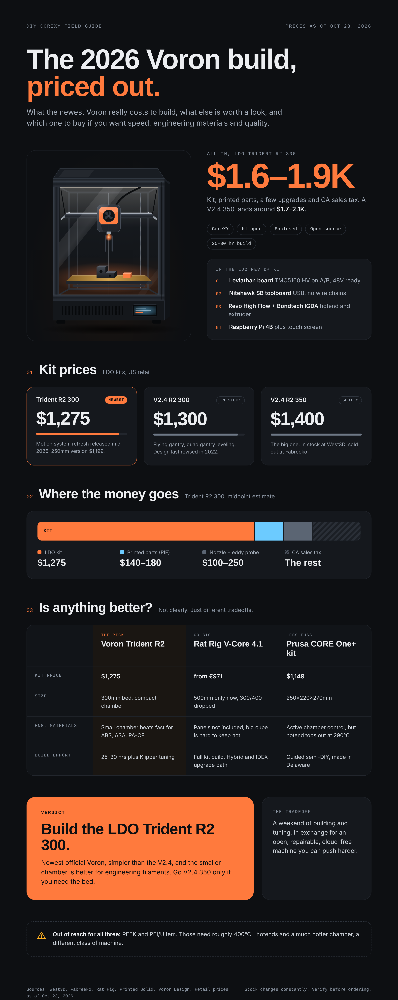

# Voron Trident R2 Build

<!-- CONSTITUTION_START -->
[](https://github.com/esanacore/engineering-constitution)
<!-- CONSTITUTION_END -->

Build log, decisions, costs and printer config for an LDO Voron Trident R2 300 aimed at fast printing in engineering materials (ABS, ASA, PA-CF). This repo is for me and anyone else planning a similar build in late 2026.

[](docs/infographic/voron-build-cost-2026.png)

<sub>Prices as of Oct 23, 2026. Full numbers and sources in [docs/COST_BREAKDOWN.md](docs/COST_BREAKDOWN.md). Editable source: [docs/infographic/voron-build-cost-2026.html](docs/infographic/voron-build-cost-2026.html).</sub>

## Current Capabilities

- Platform decision recorded and reasoned: [ADR-0001](docs/adr/0001-printer-platform-voron-trident-r2-300.md) (Proposed)
- Dated cost breakdown with sources for the kit, printed parts, upgrades and alternatives
- Infographic summarizing the cost and the platform comparison, rendered from HTML by a script
- Docs gate (`scripts/check_docs.sh`) that runs in CI on every push

Not yet: purchased parts, build log, Klipper config. Those land as the build progresses (see [TODO.md](TODO.md)).

## Quick Start

There is no software to install. To read the plan, start with the infographic above, then the ADR and cost breakdown.

```bash
git clone https://github.com/esanacore/voron-trident-r2-build.git
cd voron-trident-r2-build
```

<details>
<summary>Re-render the infographic (Windows, PowerShell)</summary>

```powershell
py -m pip install playwright
py -m playwright install chromium
py scripts\render_infographic.py
```

</details>

<details>
<summary>Re-render the infographic (Linux / WSL2)</summary>

```bash
python3 -m pip install playwright
python3 -m playwright install chromium
python3 scripts/render_infographic.py
```

</details>

<details>
<summary>Run the docs check</summary>

```bash
bash scripts/check_docs.sh
```

On Windows, run it from Git Bash or WSL2.

</details>

## The Build at a Glance

| Item | Choice | Why |
| --- | --- | --- |
| Printer | LDO Voron Trident R2 300 (Rev D+) | Newest official Voron, smaller chamber heats well for engineering filaments |
| Kit price | $1,274.99 (West3D, Oct 2026) | In stock at time of writing |
| All-in estimate | $1,600 to $1,900 | Kit, printed parts, hardened nozzle, eddy probe, CA sales tax |
| Firmware | Klipper | Stock for Voron |
| Fallback | Voron 2.4 R2 350 | Only if a bigger bed becomes a hard requirement |

## Documentation

| Doc | What it covers |
| --- | --- |
| [docs/COST_BREAKDOWN.md](docs/COST_BREAKDOWN.md) | Every price, where it came from, and the date |
| [docs/adr/](docs/adr/) | Architecture decision records for the build |
| [docs/HELP.md](docs/HELP.md) | How this repo is organized and how to update it |
| [TODO.md](TODO.md) | Build phases and what is next |
| [CHANGELOG.md](CHANGELOG.md) | What changed and when |

<details>
<summary>Project tree</summary>

```text
.
├── README.md
├── CHANGELOG.md
├── TODO.md
├── AGENTS.md
├── LICENSE
├── .github/
│   ├── SECURITY.md
│   └── workflows/docs.yml
├── docs/
│   ├── HELP.md
│   ├── COST_BREAKDOWN.md
│   ├── adr/0001-printer-platform-voron-trident-r2-300.md
│   └── infographic/
│       ├── voron-build-cost-2026.html
│       └── voron-build-cost-2026.png
├── scripts/
│   ├── check_docs.sh
│   └── render_infographic.py
└── wiki/Home.md
```

</details>

## Safety Notes

This printer runs a mains-powered PSU and a 100°C+ bed inside an enclosure. Follow the Voron manual's wiring and grounding steps, use the fuses and ferrules the kit specifies, and run a carbon filter for ABS and ASA fumes. Never leave the first heat cycles unattended.

## License

GPL-3.0, matching Voron Design and Klipper so configs and derived parts can be shared back. See [LICENSE](LICENSE).
